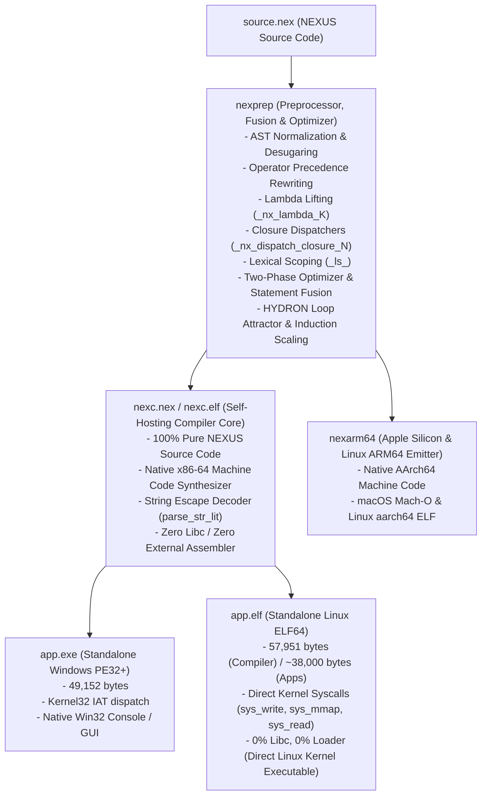

# NEXUS: Standalone Native AOT Compiler & Toolchain (v8.6 Stage 5)
### Self-Hosted Compiler Core | Tri-Platform (Linux ELF64, Windows PE32+, macOS ARM64) | 0% libc | HYDRON Engine

[](PROJECT_STATE.md)
[](https://github.com/TouchOfDeath/nexus/actions)
[](LICENSE)
[](compiler/nexc.nex)
[-orange.svg)](compiler/nexc.elf)
[](bin/nexarm64)
[](nexus)
[](nexus)
[](docs/README.md)

Welcome to **NEXUS**, an autonomous programming language and native Ahead-Of-Time (AOT) compiler toolchain.

NEXUS features a **self-hosted compiler core**: [`compiler/nexc.nex`](compiler/nexc.nex) is written entirely in pure NEXUS source code, compiles itself, and produces bit-for-bit identical native machine code binaries across bootstrap generations (**0 differences across all 49,152 bytes** on PE32+ and **0 byte differences** on direct Linux ELF64). The surrounding bootstrap, cross-platform emitter, and development tooling ecosystem includes native C, Python, C#, and shell components.

NEXUS emits true native binaries across three major operating systems:
1. **Linux x86-64 ELF64 (`app.elf`)**: 100% standalone native executable with direct kernel syscalls (**0% libc, 0% ld-linux, 0% Wine, 0% loader**).
2. **Windows x86-64 PE32+ (`app.exe`)**: Standalone portable executable with direct Kernel32 IAT imports.
3. **Apple Silicon & Linux ARM64 (`app.macho` / `app.elf`)**: Native ARM64 machine code generation via standalone emitter.

---

## 🚀 Recent Release Highlights (v8.0 – v8.6)

- **v8.6 — 15 Foundational Standard Library Features & Compiler Hardening (2026-10-17)**:
  - **Memory & Buffers**: Fast memory move/set/zero with overlap-safe `nx_memmove` (`stdlib/memory.nex`), growable Little-Endian `ByteBuffer` for binary wire protocols (`stdlib/byte_buffer.nex`), and LSB-first `BitStream` reader/writer (`stdlib/bit_stream.nex`).
  - **Data Structures**: Min/Max Priority Queue / Binary Heap (`stdlib/priority_queue.nex`), Doubly-Linked List with O(1) removal (`stdlib/linked_list.nex`), Character Trie / Prefix Tree (`stdlib/trie.nex`), and fixed-capacity LRU Cache with tombstone revival (`stdlib/lru_cache.nex`).
  - **Memory Management**: Chunked bump Arena Allocator with 8-byte alignment and O(1) bulk reset (`stdlib/arena.nex`).
  - **Encoding & Text**: Strict RFC 3629 UTF-8 validate/decode/encode rejecting overlong and surrogate encodings (`stdlib/unicode.nex`), tokenizing string split and join (`stdlib/strings.nex`).
  - **Algorithms**: Binary search primitives for exact match, lower bound, and upper bound (`stdlib/search.nex`).
  - **Compiler Operator Precedence (BUG 4 RESOLVED)**: Fixed `prec_rewrite` in `tools/nexprep.c` to partition mixed infix expressions into multiplicative terms (`*`, `/`, `%`) and additive terms (`+`, `-`), preserving Horner base-65536 expansions (`1 + 2 * 3 == 7`, `10 - 2 * 3 == 4`, `1 + 2 * 3 + 4 == 11`).
  - **Diagnostics & Error Gating (BUGS 2 & 3 RESOLVED)**: Fixed `report_err` in `compiler/nexc.nex` to print exact diagnostic strings without clobbered helper offsets; 13/13 diagnostics pass and suppress output on error.
- **v8.5 — Modern Loop & Range Ergonomics + Standard Library Additions (2026-10-16)**:
  - **Compile-Time Constants (`const`)**: Scoped and top-level immutable declarations (`const NAME = expr`) with compile-time integer constant folding.
  - **Range Expressions in Loops (`..`, `..=`)**: Exclusive (`0..10`) and inclusive (`0..=10`) range syntax with optional custom stride (`step 2`, `step -2`).
  - **Null Coalescing Operator (`??`)**: Short-circuiting fallback expressions (`let title = opt_title ?? "Untitled"`).
  - **Collections**: Circular Ring Buffer / Deque (`stdlib/ring_buffer.nex`), Dense BitSet / BitVector (`stdlib/bitset.nex`), and HashSet (`stdlib/hashset.nex`).
  - **String Helpers**: `nx_str_starts_with`, `nx_str_ends_with`, `nx_str_trim`, `nx_str_normalize_newlines`, `nx_str_escape_literal`.
- **v8.4 — Syntax Ergonomics Bundle (2026-10-14)**:
  - **Octal Number Literals**: POSIX permission literals `0o755`, `0o644`, `0o10`.
  - **Increment & Decrement**: Concise `++` and `--` operators in pre- and post-fix positions.
  - **Ternary Expressions**: Inline conditional evaluation `cond ? expr1 : expr2`.
- **v8.3 — Advanced Text Buffering**:
  - **Piece Table Text Buffer (`stdlib/piece_table.nex`)**: Production-grade buffer backing the NEXUS IDE with line navigation, slice export, and atomic snapshot undo/redo.
- **v8.2+ — String Escapes & Universal Decoding**:
  - Full C-style string escape sequences (`\n`, `\t`, `\r`, `\\`, `\"`, `\0`, `\e`, `\xHH`) directly emitted into binary `.rdata` by the self-hosted compiler core.
  - Two-phase loop optimizer: statement fusion, generalized induction scaling (x128), and invariant conditional peeling (x64).
- **v8.1 — 10 Priority Systems & Multi-Platform Capabilities**:
  - Hexadecimal (`0x...`) and binary (`0b...`) integer literals.
  - Native bitwise logic (`&`, `|`, `^`, `~`, `<<`, `>>`) and compound updates.
  - Dynamic Vector (`Vec`) and Associative Hash Map (`HashMap`).
  - Non-blocking async event loop (`poll`/`epoll`) with direct Linux kernel syscalls.
  - Official deterministic 3-stage bootstrap (`./nexus bootstrap`).
- **v8.0 — Typed CFG Intermediate Representation (N-IR)**:
  - 3-address basic-block structured IR with typed virtual registers, multi-pass optimizer, and differential fuzzer.
- **v7.3 — HYDRON Phase 4: Scalar Evolution (SCEV) Recurrence Attractor Solver**:
  - Solves non-linear recurrence update loops ($acc_{n+1} = \lfloor(acc_n + n) / 2\rfloor$) mathematically, reducing a 50M-iteration loop to 0.40 ms (~156.7x computation reduction).

---

## 🌟 Repository Structure

```
nexus_project/
├── README.md                  <- Project landing page, architecture & quick start
├── PROJECT_STATE.md           <- Detailed living state, metrics & milestones
├── CHANGES.md                 <- Ecosystem release changelog across compiler versions
├── 500_FEATURES_NEEDED.md     <- Long-term architectural roadmap & feature gap analysis
├── FINDINGS.md                <- Bug investigation logs & verified fixes
├── LLMS.txt                   <- LLM & AI coding assistant prompt reference guide
├── nexus                      <- Master toolchain CLI driver (Linux, Windows, macOS)
├── nexus.cmd / nexus.ps1      <- Zero-dependency Windows CLI drivers (Batch & PowerShell)
├── build_all.sh / .ps1        <- Master multi-platform build & verification pipelines
│
├── bin/                       <- Built Native Toolchain Binaries
│   ├── nexprep / .exe         <- Preprocessor, statement fusion & loop optimizer
│   ├── nexelf / .exe          <- Standalone native Linux ELF64 binary emitter
│   ├── nexmacho / .exe        <- Standalone native macOS ARM64 Mach-O emitter
│   ├── nexarm64 / .exe        <- Native Apple Silicon ARM64 AOT compiler
│   ├── nexir / .exe           <- N-IR typed intermediate representation optimizer & VM
│   ├── nextest / .exe         <- Native test assertion harness runner
│   ├── nexfmt / .exe          <- Idempotent source code formatter
│   └── nexload                <- Zero-dependency PE32+ bridge
│
├── compiler/                  <- NEXUS Native Self-Hosting Compiler
│   ├── nexc.nex               <- Self-hosting compiler source in pure NEXUS (~2,000 lines)
│   ├── nexc.elf               <- Standalone Linux ELF64 compiler (57,951 bytes - Direct Kernel)
│   ├── nexc.exe               <- Standalone Windows PE32+ compiler (49,152 bytes)
│   ├── nexc2.exe / nexc2.elf  <- Generation 2 compiler (verified bitwise identical)
│   ├── nexc3.exe / nexc3.elf  <- Generation 3 compiler (verified bitwise identical)
│   └── nexc4.exe / nexc4.elf  <- Generation 4 compiler (100% fixed point convergence)
│
├── stdlib/                    <- Standard Library Modules (100% pure NEXUS)
│   ├── nstdlib.nex            <- Master include bundle
│   ├── arena.nex              <- Chunked bump/arena allocator (Feature #96)
│   ├── arrays.nex             <- Contiguous byte array utilities
│   ├── assert.nex             <- Assertion framework backing assert_eq / assert_ne
│   ├── bit_stream.nex         <- LSB-first bit reader/writer (Feature #100)
│   ├── bitset.nex             <- Dense BitSet / BitVector (Feature #78)
│   ├── bitwise.nex            <- 64-bit bitwise logic (&, |, ^, ~, <<, >>) & compound updates
│   ├── byte_buffer.nex        <- Growable little-endian ByteBuffer (Feature #99)
│   ├── calculus.nex           <- Numerical differentiation and integration
│   ├── combinatorics.nex      <- Permutations, combinations, and factorials
│   ├── complex.nex            <- Complex number operations
│   ├── font.nex               <- 8x8 bitmap font rendering engine
│   ├── framebuffer.nex        <- 32-bit software rasterizer & pixel blitter
│   ├── hashmap.nex            <- Associative hash map with linear probing & string keys
│   ├── hashset.nex            <- Hash set (int/string elements) with probing & rehash (Feature #71)
│   ├── http.nex               <- Native HTTP/1.1 web server & JSON engine
│   ├── linalg.nex             <- Vector & matrix linear algebra
│   ├── linked_list.nex        <- Doubly-linked list (Feature #77)
│   ├── lru_cache.nex          <- Fixed-capacity LRU cache (Feature #94)
│   ├── math.nex               <- Math utilities (max, min, clamp, sign, pow, isqrt, gcd, lcm)
│   ├── math_trig.nex          <- Trigonometric functions
│   ├── memory.nex             <- Fast memmove/memcpy/memset/memzero (Features #87, #88)
│   ├── number_theory.nex      <- Prime tests, modular arithmetic, totient
│   ├── piece_table.nex        <- Piece-table text buffer with undo/redo (Feature #67)
│   ├── poll.nex               <- Non-blocking async event loop (sys_epoll)
│   ├── priority_queue.nex     <- Min/max binary heap (Feature #76)
│   ├── qarrays.nex            <- 64-bit integer array utilities
│   ├── rational.nex           <- Exact rational fractions
│   ├── ring_buffer.nex        <- Circular Ring Buffer / Deque (Features #74, #75)
│   ├── search.nex             <- Binary search exact/lower/upper bounds (Feature #93)
│   ├── sets.nex               <- Mathematical set operations
│   ├── sound.nex              <- Audio synthesis & waveform generation
│   ├── sprite.nex             <- 2D sprite rendering
│   ├── statistics.nex         <- Mean, variance, standard deviation, median
│   ├── strings.nex            <- String utilities, split/join, trim, normalization
│   ├── trie.nex               <- Character prefix tree (Feature #80)
│   ├── unicode.nex            <- Strict UTF-8 validate/decode/encode (Features #113-115)
│   ├── vec.nex                <- Growable dynamic array vector with amortized O(1) push/pop
│   └── x11.nex                <- Direct X11 wire protocol graphical windowing
│
├── examples/                  <- Sample Programs, Demos & Games
│   ├── nexus_ide.nex          <- Pure native NEXUS graphical code studio (100% NEXUS)
│   ├── gui_flappy.nex         <- Pure native 60 FPS Flappy Bird game (X11)
│   ├── raycaster_3d.nex       <- Wolfenstein 3D style raycaster engine (X11)
│   ├── web_server.nex         <- Bare-metal HTTP server & JSON telemetry API
│   ├── neural_network.nex     <- 2-layer backpropagation XOR neural network
│   ├── rocket_physics.nex     <- Numerical simulation of orbital mechanics
│   └── recursion_showcase.nex <- Deep recursion: Ackermann, Fibonacci, GCD
│
├── tests/                     <- Comprehensive Test Suites (27 example suites, 26 stdlib suites)
│   ├── test_arena.nex         <- Chunked bump allocator suite
│   ├── test_bit_stream.nex    <- Bit stream I/O suite
│   ├── test_bitset.nex        <- Dense BitSet suite
│   ├── test_byte_buffer.nex   <- ByteBuffer serialization suite
│   ├── test_closures.nex      <- Closures, lambdas & environment capture
│   ├── test_hashmap.nex       <- Hash map insertion, retrieval & collision probing
│   ├── test_hashset.nex       <- Hash set membership, dedupe & tombstones
│   ├── test_linked_list.nex   <- Doubly-linked list suite
│   ├── test_loop_ranges_v84.nex<- Range loops (0..N, step S), const, ??
│   ├── test_lru_cache.nex     <- LRU cache eviction & rebuild suite
│   ├── test_memory.nex        <- Memmove overlap-safety, memset & memzero
│   ├── test_priority_queue.nex<- Min/max binary heap suite
│   ├── test_ring_buffer.nex   <- Circular buffer & deque suite
│   ├── test_search.nex        <- Binary search suite
│   ├── test_string_escapes.nex<- String escape sequences (\n, \t, \r, \\, \", \0, \e, \xHH)
│   ├── test_string_split_join.nex<- String split & join suite
│   ├── test_syntax_v83.nex    <- Octal literals (0o...), ++/--, ternary ? :
│   ├── test_trie.nex          <- Trie prefix tree suite
│   ├── test_type_inference.nex<- Type inference suite
│   └── test_unicode.nex       <- Strict RFC 3629 UTF-8 suite
│
├── tools/                     <- Toolchain Source & Diagnostic Engines
│   ├── nexprep.c              <- Preprocessor, statement fusion & loop optimizer source
│   ├── nexarm64.c             <- ARM64 native machine code emitter
│   ├── nexir.c                <- N-IR intermediate representation engine
│   ├── nexdelta.py            <- Automated delta debugging test reducer
│   ├── nexfuzz.py             <- 7-way differential grammar fuzzer
│   ├── nexinterp.py           <- Reference semantic oracle interpreter
│   └── tcc/                   <- Bundled zero-install Tiny C Compiler for Windows
│
└── docs/                      <- Documentation Hub (docs/README.md)
    ├── README.md              <- Documentation index & navigation hub
    ├── LANGUAGE_REFERENCE.md  <- Complete grammar, semantics & gotchas
    ├── TUTORIAL.md            <- Hands-on tutorial from Hello World to stdlib
    ├── BUILTINS.md            <- Built-in operations & standard library API reference
    ├── NEXUS_IR_SPECIFICATION.md <- N-IR intermediate representation blueprint
    ├── TECHNICAL_AUDIT.md     <- Independent technical audit & architectural guidance
    ├── 500_FEATURES_NEEDED.md <- Complete 500-feature roadmap & tracking
    ├── BENCHMARK_RESULTS.txt  <- Scientific two-category benchmark report
    └── index.html             <- Interactive HTML documentation portal
```

---

## ⚡ Quick Start

### Build and Run with `./nexus` (Linux & macOS)

```bash
# 1. Run any NEXUS program (compiles to ELF64 and executes directly on Linux kernel)
./nexus run examples/rocket_physics.nex
./nexus run examples/fibonacci.nex

# 2. Run new language feature test suites
./nexus run tests/test_closures.nex
./nexus run tests/test_frame_pointers.nex
./nexus run tests/test_default_params.nex

# 3. Launch the Pure Native NEXUS IDE (100% Machine Code)
./nexus ide

# 4. Run the full regression test suite (27 examples, 13 diagnostics, 50 foundation, 26 stdlib)
./nexus test

# 5. Verify Stage 5 Bit-for-Bit Self-Hosting Parity (PE32+ and ELF64)
./nexus self-host

# 6. Run raw native AOT code-generation benchmark (50M un-eliminated physical iters)
./nexus bench

# 7. Run HYDRON semantic loop elimination benchmark (recurrence attractor solver)
./nexus hydron

# 8. Format code idempotently
./nexus fmt examples/fibonacci.nex

# 9. Start the interactive REPL
./nexus repl
```

### Build and Run on Windows (`nexus.cmd` / `nexus.ps1`)

NEXUS includes full first-class native Windows support with **zero external dependencies** (no Visual Studio, C++ SDK, Python, or Linux/WSL required):

```powershell
# 1. Run any NEXUS program natively on Windows
nexus run examples\rocket_physics.nex
nexus run examples\fibonacci.nex

# 2. Compile to a standalone native Windows executable
nexus build examples\fibonacci.nex -o fib.exe
.\fib.exe

# 3. Run the automated compiler test harness
nexus test

# 4. Benchmark native performance and HYDRON optimization
nexus bench
nexus hydron

# 5. Inspect and disassemble native Windows binaries
nexus dump compiler\nexc.exe
nexus disasm compiler\nexc.exe -n 25

# 6. Verify Stage 5 Bit-for-Bit Self-Hosting Parity (Gen1 == Gen2 bitwise)
nexus self-host

# 7. Execute the full master build & verification pipeline
.\build_all.ps1
```

---

## 📋 NEXUS Language Syntax Showcase

### 1. Parameterized Functions with Returns & Default Values
```nexus
fn greet(name, times = 1) {
    let i = 0
    while i < times {
        print name
        let i = i + 1
    }
    return times
}

greet("NEXUS")             # Uses default times = 1
greet("NEXUS", 3)          # Overrides default
```

### 2. Closures & Anonymous Functions (Lambdas)
```nexus
# Inline single-expression lambda
let double = |x| x * 2
let ans = double(21)       # 42

# Environment capture from enclosing scope
let factor = 10
let offset = 5
let calc = |x| x * factor + offset
let res = calc(3)          # 35

# Block-body lambda
let sum_n = |n| {
    let acc = 0
    let i = 1
    while i <= n {
        let acc = acc + i
        let i = i + 1
    }
    return acc
}
let total = sum_n(5)       # 15
```

### 3. Multiple Return Values & Named Arguments
```nexus
fn divmod(a, b) {
    let q = a / b
    let r = a % b
    return q, r
}

let quotient, remainder = divmod(14, 3)

# Named argument reordering
let res = divmod(b=3, a=14)
```

### 4. Operator Precedence & Arithmetic Expressions
Arithmetic expressions adhere to standard mathematical precedence (`*`, `/`, `%` over `+`, `-`):
```nexus
let result = 1 + 2 * 3         # Evaluates to 7 (2 * 3 first, then + 1)
let check  = 10 - 2 * 3        # Evaluates to 4
let combo  = 1 + 2 * 3 + 4     # Evaluates to 11
```

### 5. Compile-Time Constants (`const`)
```nexus
const MAX_BUFFER = 65536
const COLOR_BG   = 0x11111B
const FILE_PERM  = 0o755
const TITLE      = "NEXUS v8.6"

# Arithmetic expressions are folded at compile time
const TOTAL_SLOTS = 16 * 1024
```

### 6. Range Loops (`..` and `..=`) with Step
```nexus
# Exclusive range: 0 through 9
for i in 0..10 {
    print i
}

# Inclusive range with custom stride
for i in 0..=10 step 2 {
    print i                    # Prints 0, 2, 4, 6, 8, 10
}

# Countdown with negative step
for i in 10..0 step -2 {
    print i                    # Prints 10, 8, 6, 4, 2
}
```

### 7. Null Coalescing Operator (`??`) & Ternary Expressions (`? :`)
```nexus
# Short-circuiting null coalescing fallback
let opt_title = 0
let title = opt_title ?? "Untitled Document"

# Ternary conditional expressions
let score = 85
let grade = score >= 60 ? "Pass" : "Fail"

# Increment and decrement
let counter = 0
counter++
counter--
```

### 8. Lexical Block Scoping & Local Variables
```nexus
let x = 10
if x > 5 {
    local x = 999          # Shadows outer x strictly inside this block
    print x                # Prints 999
}
print x                    # Prints 10 (unshadowed upon block exit!)
```

### 9. Array Literals & Direct Memory Operations
```nexus
# Array literals (64-bit integer elements)
let primes = [2, 3, 5, 7, 11, 13]
let first = primes[0]
primes[0] = 99

# Heap allocation & 64-bit raw memory operations
let buf = alloc 1024
store64 [buf + 0] 123456
let val = load64 [buf + 0]
```

### 10. String Escape Sequences
Standard escape sequences decoded directly into read-only binary `.rdata`:
```nexus
let msg = "Hello\tWorld!\n\"NEXUS\" path: C:\\bin\\app\n"
let ansi = "\e[32mGreen Text\e[0m\n"
let hex_bytes = "Byte signature: \x41\x42\x43\x00"

print msg                  # Prints formatted text with tabs, quotes, and newlines
let l = len "col1\tcol2"   # Evaluates to 9 decoded bytes
```

### 11. Number Literals & Bitwise Operations
```nexus
include "stdlib/nstdlib.nex"

# Base-16, Base-2, and Base-8 literals
let hex_mask = 0xFF00
let bin_flag = 0b10101011
let oct_perm = 0o755

# Native bitwise logic and shift operations
let nx_i0 = hex_mask
let nx_i1 = bin_flag
call nx_band               # nx_r0 = hex_mask & bin_flag
call nx_bor                # nx_r0 = hex_mask | bin_flag
call nx_bxor               # nx_r0 = hex_mask ^ bin_flag
```

### 12. Standard Library Collections & Memory Primitives
```nexus
include "stdlib/nstdlib.nex"
include "stdlib/ring_buffer.nex"
include "stdlib/priority_queue.nex"
include "stdlib/byte_buffer.nex"
include "stdlib/arena.nex"
include "stdlib/unicode.nex"

# 1. Circular Ring Buffer / Deque (O(1) push/pop both ends)
let rb = nx_rb_new(8)
nx_rb_push_back(rb, 100)
nx_rb_push_front(rb, 50)
let front_val = nx_rb_pop_front(rb)    # 50

# 2. Min/Max Priority Queue (Binary Heap)
let pq = nx_pq_new(16, 0)              # min-heap
nx_pq_push(pq, 42)
nx_pq_push(pq, 10)
let min_val = nx_pq_pop(pq)            # 10

# 3. Growable Little-Endian ByteBuffer
let bb = nx_buf_new(64)
nx_buf_write_u32(bb, 0x12345678)
let read_u32 = nx_buf_read_u32(bb, 0)  # 0x12345678

# 4. Bump Arena Allocator (O(1) alloc, O(1) bulk reset)
let arena = nx_arena_new(4096)
let block = nx_arena_alloc(arena, 128)
nx_arena_reset(arena)

# 5. Strict RFC 3629 UTF-8 Validation
let is_valid = nx_utf8_validate("Hello World\n", 12) # 1
```

---

## 🏗️ Compiler Architecture & Dual-Target Pipeline



---

## ⚡ The HYDRON Acceleration Engine & Dual-Benchmark Methodology

NEXUS employs a **scientifically rigorous two-category benchmark architecture** that strictly distinguishes raw CPU code generation from semantic computation elimination:

### 1. Category A: Raw Native AOT Code Generation (`./nexus bench`)
Measures native machine code instruction quality across **50,000,000 physical loop iterations** with semantic loop elimination explicitly disabled (`--no-hydron`):
* **Execution Time**: ~62.5 ms (best of 3)
* **Instruction Throughput**: **~800.2M physical-iters/sec**
* **Runtime Characteristics**: Pure self-hosted native machine code with **0% libc**, 0% external runtime, and direct Linux kernel ELF64 syscalls.

### 2. Category B: Semantic Computation Elimination (`./nexus hydron`)
Demonstrates the **HYDRON Engine** (Turbines 1–7), an advanced program analysis and recurrence optimization system:
* **Turbine 1**: Fast Power-of-2 Multiplication (`shl`, 1-cycle)
* **Turbine 2**: Fast Power-of-2 Truncating Division (`cqo+and+add+sar`, 4-cycle branchless sequence)
* **Turbine 3**: Redundant Store-Load Forwarding across consecutive assignments (`hyd_rax_var`)
* **Turbine 4**: Chained Expression Algebraic Reduction (`acc * 2 / 4` -> `acc / 2`)
* **Turbine 5**: Loop Optimization & 128x Step Induction Scaling with remainder cleanup
* **Turbine 6**: Register Promotion Engine & Invariant Peeling (Zero Stack RAM Writes)
* **Turbine 7**: **Scalar Evolution (SCEV) Recurrence Attractor Solver**:
  - Solves non-linear recurrence loops: $acc_{n+1} = \lfloor(acc_n + n) / 2\rfloor$
  - Executes a 64-iteration preamble to converge error exponential decay ($e_{n+1} = \lfloor e_n / 2 \rfloor$)
  - Validates dynamic fixed-point manifold invariance ($acc == i - 2$) with runtime guard
  - Derives result in $O(1)$ closed form: reduces **50,000,000 logical iterations to 0.40 ms (~156.7x computation reduction)** while verifying 100% exact numerical equivalence.

---

## 📊 Compiler Evolution & Capability Matrix

| Capability / Version | v5.0 (Self-Host) | v6.9 (Closures/FP) | v7.3 (HYDRON) | v8.1 (10 Systems) | v8.4/v8.5 (Ergonomics) | v8.6 (Stdlib & Hardening) |
| :--- | :--- | :--- | :--- | :--- | :--- | :--- |
| **Self-Hosting Status** | **100% (`nexc.nex`)** | **100% (`nexc.nex`)** | **100% (`nexc.nex`)** | **100% (`nexc.nex`)** | **100% (`nexc.nex`)** | **100% (`nexc.nex`)** |
| **Stage 5 Deterministic Parity** | 100% (Gen3 == Gen4) | 100% Bit-for-Bit | 100% Bit-for-Bit | 100% Fixed Point | 100% Bit-for-Bit | **100% Bit-for-Bit (PE & ELF)** |
| **Direct Linux Kernel ELF64** | No (via bridge) | **Yes (0% libc)** | **Yes (0% libc)** | **Yes (0% libc)** | **Yes (0% libc)** | **Yes (0% libc / 0% loader)** |
| **macOS ARM64 Mach-O** | No | **Yes (Native Mach-O)** | **Yes (Native Mach-O)** | **Yes (Native Mach-O)** | **Yes (Native Mach-O)** | **Yes (Native Mach-O)** |
| **Windows Native Support** | Basic PE32+ | Basic PE32+ | Basic PE32+ | **Zero-Dep (TCC/Win32)** | **Zero-Dep (TCC/Win32)** | **Zero-Dep (TCC/Win32)** |
| **Operator Precedence** | Left-to-right | Left-to-right | Left-to-right | Left-to-right | Left-to-right | **Standard (*, /, % over +, -)** |
| **Function Parameters & Returns** | Hardware ret | `fn add(a, b)` | `fn add(a, b)` + return | Parameterized + Defaults | Parameterized + Defaults | **Parameterized + Defaults** |
| **Closures & Lambdas** | No | `\|x\| expr`, Captures | `\|x\| expr`, Captures | `\|x\| expr`, Captures | `\|x\| expr`, Captures | **`\|x\| expr`, Captures** |
| **String Escape Sequences** | No | No | No | No | `\n`, `\t`, `\r`, `\\`, `\"`, `\xHH` | **Universal (\n, \t, \r, \\, \", \0, \e, \xHH)** |
| **Number Literals** | Decimal | Decimal | Decimal | Decimal, Hex, Binary | + Octal (`0o...`) | **Decimal, Hex, Binary, Octal** |
| **Language Ergonomics** | Basic | Scoping, Lambdas | Multi-returns | Bitwise ops | `const`, `0..N`, `??`, `++`, `? :` | **Full Ergonomics Suite** |
| **Standard Library Modules** | Minimal (arrays) | Math, Arrays | Graphics, X11 | Vec, HashMap, Poll | PieceTable, RingBuf, BitSet | **30+ Modules (Arena, BB, Trie, LRU, UTF8)** |
| **HYDRON Engine** | None | None | Turbines 1–7 (Attractor) | Turbines 1–7 | Fusion + Loop Engine | **Turbines 1–7 + Fusion + Precedence** |
| **Deterministic Bootstrap** | Ad-hoc | Ad-hoc | Ad-hoc | `./nexus bootstrap` | `./nexus bootstrap` | **`./nexus bootstrap` (3-stage bitwise)** |

---

## 🛠️ Verification & Test Suite

The test suite validates compiler diagnostics, foundational features, standard library modules, optimizer rules, type inference, native IDE functionality, and string escapes:

```bash
./nexus test
```

Summary output:
```text
Running NEXUS test suite on Linux (Direct Native ELF64 Execution)...
[+] 27 Example Suites           PASS (Direct Native ELF64)
[+] 13/13 Compiler Diagnostics  PASS (gated, error caught)
[+] 50/50 Foundation Tests      PASS (precedence, math, floats, recursion, scoping)
[+] 3/3 Interactive Tests       PASS (calculator, prime checker)
[+] Stdlib suite (122 asserts)  PASS
[+] Optimizer suite (52 asserts)PASS
[+] Type inference (7 categories)PASS
[+] Native IDE (100% NEXUS)     PASS (PE32+ & ELF64)
[+] HYDRON correctness suite    PASS
[+] String escapes suite        PASS
[+] Piece table suite           PASS (Feature #67)
[+] Syntax suite (0o, ++, ?:)   PASS (Features #30, #35, #36)
[+] Loop & Range suite          PASS (Features #37, #50, #59)
[+] Hash set suite              PASS (Feature #71)
[+] Dense bitset suite          PASS (Feature #78)
[+] Circular ring buffer suite  PASS (Features #74, #75)
[+] Memory primitives suite     PASS (Features #87, #88)
[+] ByteBuffer suite            PASS (Feature #99)
[+] Bit stream suite            PASS (Feature #100)
[+] Priority queue suite        PASS (Feature #76)
[+] Linked list suite           PASS (Feature #77)
[+] Trie suite                  PASS (Feature #80)
[+] LRU cache suite             PASS (Feature #94)
[+] Arena allocator suite       PASS (Feature #96)
[+] Unicode UTF-8 suite         PASS (Features #113-115)
[+] Split/Join string suite     PASS (Features #133, #134)
[+] Binary search suite         PASS (Feature #93)
Completed: All suites PASS. 100% Green.
```

---

## 📜 License

NEXUS is open-source software released under the MIT License.
