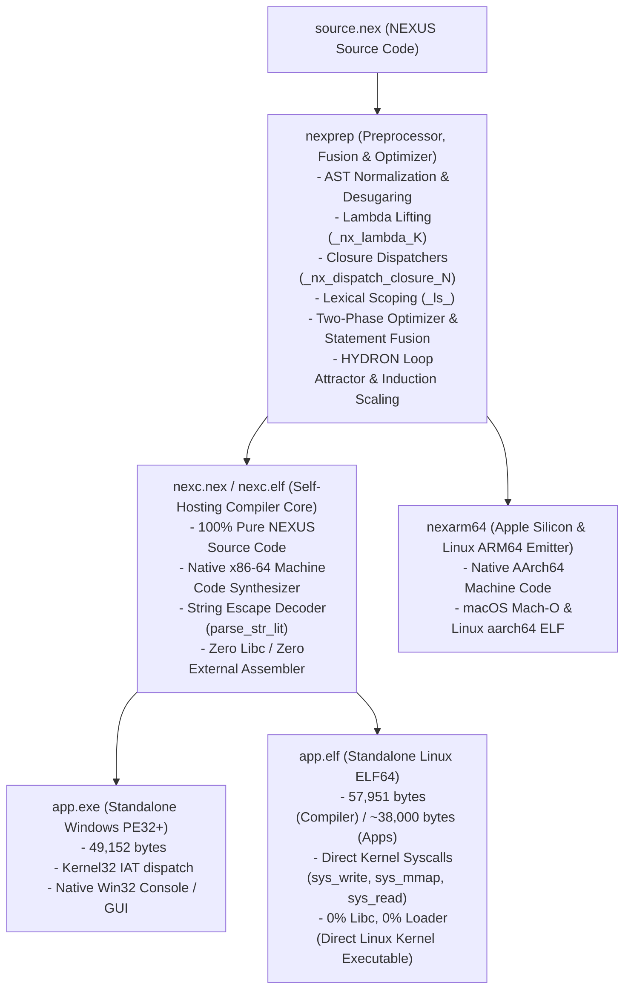

# NEXUS: Standalone Native AOT Compiler & Toolchain (v8.2 Stage 5)
### Self-Hosted Compiler Core | Tri-Platform (Linux ELF64, Windows PE32+, macOS ARM64) | 0% libc | HYDRON Engine

[](file:///PROJECT_STATE.md)
[](file:///compiler/nexc.nex)
[-orange.svg)](file:///compiler/nexc.elf)
[](file:///bin/nexarm64)
[](file:///nexus)
[](file:///nexus)

Welcome to **NEXUS**, an autonomous programming language and native Ahead-Of-Time (AOT) compiler toolchain.

NEXUS features a **self-hosted compiler core**: [`compiler/nexc.nex`](file:///compiler/nexc.nex) is written entirely in pure NEXUS source code, compiles itself, and produces bit-for-bit identical native machine code binaries across bootstrap generations (**0 differences across all 49,152 bytes** on PE32+ and **0 byte differences** on direct Linux ELF64). The surrounding bootstrap, cross-platform emitter, and development tooling ecosystem includes native C, Python, C#, and shell components.

NEXUS emits true native binaries across three major operating systems:
1. **Linux x86-64 ELF64 (`app.elf`)**: 100% standalone native executable with direct kernel syscalls (**0% libc, 0% ld-linux, 0% Wine, 0% loader**).
2. **Windows x86-64 PE32+ (`app.exe`)**: Standalone portable executable with direct Kernel32 IAT imports.
3. **Apple Silicon & Linux ARM64 (`app.macho` / `app.elf`)**: Native ARM64 machine code generation via standalone emitter.

---

## 🚀 Recent Release Highlights (v8.0 – v8.2+)

- **v8.2+ — Phase 1: String Escapes & Universal Escape Decoding**: Added comprehensive support for standard C-style escape sequences (`\n`, `\t`, `\r`, `\\`, `\"`, `\0`, `\e`, `\xHH`) directly encoded into binary `.rdata` by the self-hosted compiler core (`compiler/nexc.nex`). Updated `nexprep.c`, `nexarm64.c`, and reference interpreter (`nexinterp.py`) with escape-aware parsing and accurate `len "..."` byte-length folding.
- **v8.2 — Phase 2 Optimizer: Statement Fusion & Generalized Loop Engine**: Two-phase optimization pipeline (`tools/nexprep.c`) combining statement fusion (dead intermediate store elimination) with generalized induction scaling (x128), invariant conditional peeling (x64), and opt-in guarded unrolling. Enforces lexical scoping integrity for `local` loop counters and code-size budget protection. Realistic mixed workloads accelerate by **~92x** with 100% bit-identical output.
- **v8.1 — 10 Priority Systems & Multi-Platform Capabilities**:
  - **Hexadecimal & Binary Number Literals**: Native parsing of `0x...` (hex) and `0b...` (binary) literals in `compiler/nexc.nex`.
  - **Native Bitwise Operators & Shifts**: Full support for `&`, `|`, `^`, `~`, `<<`, `>>` and compound updates (`&=`, `|=`, `^=`, `<<=`, `>>=`).
  - **Dynamic Vector (`Vec`)**: Amortized $O(1)$ growable dynamic array in `stdlib/vec.nex`.
  - **Associative Hash Map (`HashMap`)**: String-keyed linear probing hash map in `stdlib/hashmap.nex`.
  - **Non-Blocking Async Event Loop (`poll`/`epoll`)**: Direct Linux kernel polling syscalls (`sys_epoll`) in `stdlib/poll.nex`.
  - **Official Deterministic 3-Stage Bootstrap**: `./nexus bootstrap` driver proving Gen1 == Gen2 == Gen3 bit-for-bit self-hosting convergence.
  - **Automated Delta Debugger**: Automated failing test reducer in `tools/nexdelta.py` (`./nexus delta`).
  - **N-IR ARM64 Machine Codegen**: Standalone Linux aarch64 ELF and macOS Mach-O emitters in `tools/nexir.c`.
  - **Zero-Dependency Native Windows Toolchain**: Bundled TCC and C# diagnostics via `nexus.cmd`, `nexus.ps1`, and `build_all.ps1`.
- **v8.0 — Typed CFG Intermediate Representation (N-IR)**: 3-address basic-block structured IR with typed virtual registers, 4-pass optimizer (constant folding, algebraic simplification, DCE, HYDRON IR loop solver), native x86-64 machine codegen, and 7-way differential fuzzer (`./nexus fuzz`).
- **v7.3 — HYDRON Phase 4: Scalar Evolution (SCEV) Recurrence Attractor Solver**: Solves non-linear division recurrence update loops ($acc_{n+1} = \lfloor(acc_n + n) / 2\rfloor$), reducing a 50M-iteration loop to 0.40 ms (~156.7x computation reduction).

---

## 🌟 Repository Structure

```
nexus_project/
├── LLMS.txt                   <- LLM & AI assistant prompt reference guide
├── README.md                  <- Project landing page, architecture & guide
├── PROJECT_STATE.md           <- Detailed living state, metrics & milestones
├── 500_FEATURES_NEEDED.md     <- Long-term architectural roadmap & feature gap analysis
├── CHANGES.md                 <- Ecosystem changelog across compiler versions
├── nexus                      <- Master toolchain CLI driver (Linux, Windows, macOS)
├── nexus.cmd / nexus.ps1      <- Native Windows CLI driver (PowerShell & Batch)
├── build_all.sh / .ps1        <- Master multi-platform verification pipelines
│
├── bin/                       <- Built Native Toolchain Binaries
│   ├── nexprep / .exe         <- AST normalization, statement fusion & loop optimizer
│   ├── nexelf / .exe          <- Standalone native Linux ELF64 binary emitter
│   ├── nexmacho / .exe        <- Standalone native macOS ARM64 Mach-O emitter
│   ├── nexarm64 / .exe        <- Native Apple Silicon ARM64 AOT compiler
│   ├── nexir / .exe           <- N-IR typed intermediate representation optimizer & VM
│   ├── nextest / .exe         <- Native test assertion harness runner
│   ├── nexfmt / .exe          <- Idempotent source code formatter
│   └── nexload                <- Zero-dependency PE32+ bridge
│
├── compiler/                  <- NEXUS Native Self-Hosting Compiler
│   ├── nexc.nex               <- Self-hosting compiler source in pure NEXUS (~2,000 lines)
│   ├── nexc.elf               <- Standalone Linux ELF64 compiler (57,951 bytes - Direct Kernel)
│   ├── nexc.exe               <- Standalone Windows PE32+ compiler (49,152 bytes)
│   ├── nexc2.exe / nexc2.elf  <- Generation 2 compiler (verified bitwise identical)
│   ├── nexc3.exe / nexc3.elf  <- Generation 3 compiler (verified bitwise identical)
│   └── nexc4.exe / nexc4.elf  <- Generation 4 compiler (100% fixed point convergence)
│
├── stdlib/                    <- Standard Library Modules (100% pure NEXUS)
│   ├── nstdlib.nex            <- Master include (math, arrays, strings, vec, hashmap, bitwise, assert)
│   ├── vec.nex                <- Growable dynamic array vector with amortized O(1) push/pop
│   ├── hashmap.nex            <- Associative hash map with linear probing & string keys
│   ├── hashset.nex            <- Hash set (int/string elements) with probing, tombstones & rehash
│   ├── poll.nex               <- Direct Linux kernel non-blocking async event loop (sys_epoll)
│   ├── bitwise.nex            <- 64-bit bitwise logic (&, |, ^, ~, <<, >>) & compound updates
│   ├── math.nex               <- Math utilities (max, min, clamp, sign, pow, isqrt, gcd, lcm, fib, prime)
│   ├── arrays.nex             <- Contiguous byte array utilities (fill, iota, sum, max, min, reverse, sort)
│   ├── qarrays.nex            <- 64-bit integer array utilities
│   ├── strings.nex            <- String utilities (len, copy, cmp, concat, chr, starts/ends, trim, newline normalization, escaped literals, atoi, itoa)
│   ├── assert.nex             <- Assertion framework backing assert_eq / assert_ne
│   ├── http.nex               <- Native HTTP/1.1 web server & JSON engine
│   ├── x11.nex                <- Direct X11 wire protocol graphical windowing
│   ├── framebuffer.nex        <- 32-bit software rasterizer & pixel blitter
│   ├── font.nex               <- 8x8 bitmap font rendering engine
│   ├── memory.nex             <- memmove/memset/memzero primitives (Features #87, #88)
│   ├── byte_buffer.nex        <- Growable little-endian ByteBuffer (Feature #99)
│   ├── bit_stream.nex         <- LSB-first bit reader/writer (Feature #100)
│   ├── priority_queue.nex     <- Min/max binary heap (Feature #76)
│   ├── linked_list.nex        <- Doubly-linked list (Feature #77)
│   ├── trie.nex               <- Character prefix tree (Feature #80)
│   ├── lru_cache.nex          <- Fixed-capacity LRU cache (Feature #94)
│   ├── arena.nex              <- Chunked bump/arena allocator (Feature #96)
│   ├── unicode.nex            <- Strict UTF-8 validate/decode/encode (Features #113-115)
│   ├── search.nex             <- Binary search exact/lower/upper bounds (Feature #93)
│   └── piece_table.nex        <- Piece-table text buffer with undo/redo (Feature #67)
│
├── examples/                  <- Sample Programs, Demos & Games
│   ├── nexus_ide.nex          <- Pure native NEXUS graphical code studio (100% NEXUS)
│   ├── gui_flappy.nex         <- Pure native 60 FPS Flappy Bird game (X11)
│   ├── raycaster_3d.nex       <- Wolfenstein 3D style raycaster engine (X11)
│   ├── web_server.nex         <- Bare-metal HTTP server & JSON telemetry API
│   ├── neural_network.nex     <- 2-layer backpropagation XOR neural network
│   ├── rocket_physics.nex     <- Numerical simulation of orbital mechanics
│   └── recursion_showcase.nex <- Deep recursion: Ackermann, Fibonacci, GCD
│
├── tests/                     <- Comprehensive Test Suites (50+ test suites, 50 foundation tests)
│   ├── test_string_escapes.nex<- Phase 1 string escape sequences (\n, \t, \r, \\, \", \0, \e, \xHH)
│   ├── test_hex_binary.nex    <- Hexadecimal (0x...) and binary (0b...) literals
│   ├── test_bitwise_ops.nex   <- Bitwise operators and bit shifts
│   ├── test_vec.nex           <- Dynamic vector capacity doubling and operations
│   ├── test_hashmap.nex       <- Hash map insertion, retrieval, and collision probing
│   ├── test_hashset.nex       <- Hash set membership, dedupe, tombstones, rehash & string tokens
│   ├── test_poll_events.nex   <- Epoll non-blocking async event polling
│   ├── test_closures.nex      <- Closures, lambdas & environment capture
│   ├── test_frame_pointers.nex<- Stack-allocated frame pointer chains
│   ├── test_lexical_scoping.nex<- Lexical local block scoping & shadowing
│   ├── test_multi_return.nex  <- Multiple return values & named arguments
│   └── test_hydron_overflow.nex<- 64-bit integer overflow & boundary safety
│
├── tools/                     <- Toolchain Source & Diagnostic Engines
│   ├── nexprep.c              <- Preprocessor, fusion pass & loop optimizer source
│   ├── nexarm64.c             <- ARM64 native machine code emitter
│   ├── nexir.c                <- N-IR intermediate representation engine
│   ├── nexdelta.py            <- Automated delta debugging test reducer
│   ├── nexfuzz.py             <- 7-way differential grammar fuzzer
│   ├── nexinterp.py           <- Reference semantic oracle interpreter
│   └── tcc/                   <- Bundled zero-install Tiny C Compiler for Windows
│
└── docs/                      <- Documentation, Guides & Specifications
    ├── LANGUAGE_REFERENCE.md  <- Complete grammar, semantics & gotchas
    ├── TUTORIAL.md            <- Hands-on tutorial
    └── BUILTINS.md            <- Built-in operations & standard library reference
```

---

## ⚡ Quick Start

### Build and Run with `./nexus` (Linux & macOS)

```bash
# 1. Run any NEXUS program (compiles to ELF64 and executes directly on Linux kernel)
./nexus run examples/rocket_physics.nex
./nexus run examples/fibonacci.nex

# 2. Run new language feature test suites
./nexus run tests/test_closures.nex
./nexus run tests/test_frame_pointers.nex
./nexus run tests/test_default_params.nex

# 3. Launch the Pure Native NEXUS IDE (100% Machine Code)
./nexus ide

# 4. Run the full regression test suite (all 28 suites + foundation tests)
./nexus test

# 5. Verify Stage 5 Bit-for-Bit Self-Hosting Parity
./nexus self-host

# 6. Run raw native AOT code-generation benchmark (50M un-eliminated physical iters)
./nexus bench

# 7. Run HYDRON semantic loop elimination benchmark (recurrence attractor solver)
./nexus hydron

# 8. Format code idempotently
./nexus fmt examples/fibonacci.nex

# 9. Start the interactive REPL
./nexus repl
```

### Build and Run on Windows (`nexus.cmd` / `nexus.ps1`)

NEXUS includes full first-class native Windows support with **zero external dependencies** (no Visual Studio, C++ SDK, Python, or Linux/WSL required):

```powershell
# 1. Run any NEXUS program natively on Windows
nexus run examples\rocket_physics.nex
nexus run examples\fibonacci.nex

# 2. Compile to a standalone native Windows executable
nexus build examples\fibonacci.nex -o fib.exe
.\fib.exe

# 3. Run the automated compiler test harness
nexus test

# 4. Benchmark native performance and HYDRON optimization
nexus bench
nexus hydron

# 5. Inspect and disassemble native Windows binaries
nexus dump compiler\nexc.exe
nexus disasm compiler\nexc.exe -n 25

# 6. Verify Stage 5 Bit-for-Bit Self-Hosting Parity (Gen1 == Gen2 bitwise)
nexus self-host

# 7. Execute the full master build & verification pipeline
.\build_all.ps1
```

---

## 📋 NEXUS Language Syntax Showcase

### 1. Parameterized Functions with Returns & Default Values
```nexus
fn greet(name, times = 1) {
    let i = 0
    while i < times {
        print name
        let i = i + 1
    }
    return times
}

greet("NEXUS")             # Uses default times = 1
greet("NEXUS", 3)          # Overrides default
```

### 2. Closures & Anonymous Functions (Lambdas)
```nexus
# Inline single-expression lambda
let double = |x| x * 2
let ans = double(21)       # 42

# Environment capture from enclosing scope
let factor = 10
let offset = 5
let calc = |x| x * factor + offset
let res = calc(3)          # 35

# Block-body lambda
let sum_n = |n| {
    let acc = 0
    let i = 1
    while i <= n {
        let acc = acc + i
        let i = i + 1
    }
    return acc
}
let total = sum_n(5)       # 15
```

### 3. Multiple Return Values & Named Arguments
```nexus
fn divmod(a, b) {
    let q = a / b
    let r = a % b
    return q, r
}

let quotient, remainder = divmod(14, 3)

# Named argument reordering
let res = divmod(b=3, a=14)
```

### 4. Lexical Block Scoping & Local Variables
```nexus
let x = 10
if x > 5 {
    local x = 999          # Shadows outer x strictly inside this block
    print x                # Prints 999
}
print x                    # Prints 10 (unshadowed upon block exit!)
```

### 5. Array Literals & Direct Memory Operations
```nexus
# Array literals (64-bit integer elements)
let primes = [2, 3, 5, 7, 11, 13]
let first = primes[0]
primes[0] = 99

# Heap allocation & 64-bit raw memory operations
let buf = alloc 1024
store64 [buf + 0] 123456
let val = load64 [buf + 0]
```

### 6. String Escape Sequences (Phase 1)
Standard escape sequences decoded directly into read-only binary `.rdata`:
```nexus
let msg = "Hello\tWorld!\n\"NEXUS\" path: C:\\bin\\app\n"
let ansi = "\e[32mGreen Text\e[0m\n"
let hex_bytes = "Byte signature: \x41\x42\x43\x00"

print msg                  # Prints formatted text with tabs, quotes, and newlines
let l = len "col1\tcol2"   # Evaluates to 9 decoded bytes
```

### 7. Hexadecimal & Binary Literals & Bitwise Operations
```nexus
include "stdlib/nstdlib.nex"

# Base-16 and Base-2 literals
let mask = 0xFF00
let flags = 0b10101011

# Native bitwise logic and shift operations
let nx_i0 = mask
let nx_i1 = flags
call nx_band               # nx_r0 = mask & flags
call nx_bor                # nx_r0 = mask | flags
call nx_bxor               # nx_r0 = mask ^ flags
```

### 8. Standard Library Collections: `Vec` & `HashMap`
```nexus
include "stdlib/nstdlib.nex"

# Growable dynamic array (Vec)
let v = vec_new(4)
vec_push(v, 100)
vec_push(v, 200)
let item = vec_get(v, 0)   # 100
vec_free(v)

# Associative hash map (HashMap)
let map = hashmap_new(16)
hashmap_put(map, "user_id", 42)
let val = hashmap_get(map, "user_id") # 42
hashmap_free(map)
```

### 9. Frame Pointer Introspection
```nexus
let fp = frame_pointer()
let sp = stack_pointer()
let parent_fp = frame_parent(fp)
```

---

## 🏗️ Compiler Architecture & Dual-Target Pipeline



---

## ⚡ The HYDRON Acceleration Engine & Dual-Benchmark Methodology

NEXUS employs a **two-category benchmark architecture** to measure performance with scientific rigor:

### 1. Category A: Raw Native AOT Code Generation (`./nexus bench`)
Measures native machine code instruction quality across **50,000,000 physical loop iterations** with semantic loop elimination explicitly disabled (`--no-hydron`):
* **Execution Time**: ~62.5 ms (best of 3)
* **Instruction Throughput**: **~800.2M physical-iters/sec**
* **Runtime Characteristics**: Pure self-hosted native machine code with **0% libc**, 0% external runtime, and direct Linux kernel ELF64 syscalls.

### 2. Category B: Semantic Computation Elimination (`./nexus hydron`)
Demonstrates the **HYDRON Engine** (Turbines 1–7), an advanced program analysis and recurrence optimization system:
* **Turbine 1**: Fast Power-of-2 Multiplication (`shl`, 1-cycle)
* **Turbine 2**: Fast Power-of-2 Truncating Division (`cqo+and+add+sar`, 4-cycle branchless sequence)
* **Turbine 3**: Redundant Store-Load Forwarding across consecutive assignments (`hyd_rax_var`)
* **Turbine 4**: Chained Expression Algebraic Reduction (`acc * 2 / 4` -> `acc / 2`)
* **Turbine 5**: Loop Optimization & 128x Step Induction Scaling with remainder cleanup
* **Turbine 6**: Register Promotion Engine & Invariant Peeling (Zero Stack RAM Writes)
* **Turbine 7**: **Scalar Evolution (SCEV) Recurrence Attractor Solver**:
  - Solves non-linear recurrence loops: $acc_{n+1} = \lfloor(acc_n + n) / 2\rfloor$
  - Executes a 64-iteration preamble to converge error exponential decay ($e_{n+1} = \lfloor e_n / 2 \rfloor$)
  - Validates dynamic fixed-point manifold invariance ($acc == i - 2$) with runtime guard
  - Derives result in $O(1)$ closed form: reduces **50,000,000 logical iterations to 0.40 ms (~156.7x computation reduction)** while verifying 100% exact numerical equivalence.

---

## 📊 Compiler Evolution & Capability Matrix

| Capability / Version | v5.0 (Self-Host) | v6.5 (Multi-Ret/Scope) | v6.9 (Closures/FP) | v7.3 (HYDRON Engine) | v8.1 (10 Priority Systems) | v8.2+ (Optimizer & Escapes) |
| :--- | :--- | :--- | :--- | :--- | :--- | :--- |
| **Self-Hosting Status** | **100% (`nexc.nex`)** | **100% (`nexc.nex`)** | **100% (`nexc.nex`)** | **100% (`nexc.nex`)** | **100% (`nexc.nex`)** | **100% (`nexc.nex`)** |
| **Stage 5 Deterministic Parity** | 100% (Gen3 == Gen4) | 100% Parity | 100% Bit-for-Bit | 100% Bit-for-Bit | 100% Fixed Point | **100% Bit-for-Bit (PE & ELF)** |
| **Direct Linux Kernel ELF64** | No (via bridge) | Yes (Track 4) | **Yes (0% libc / 0% loader)** | **Yes (0% libc / 0% loader)** | **Yes (0% libc)** | **Yes (0% libc)** |
| **macOS ARM64 Mach-O** | No | Yes (v6.2) | **Yes (Native Mach-O)** | **Yes (Native Mach-O)** | **Yes (Native Mach-O)** | **Yes (Native Mach-O)** |
| **Windows Native Support** | Basic PE32+ | Basic PE32+ | Basic PE32+ | Basic PE32+ | **Zero-Dependency (TCC/Win32)** | **Zero-Dependency (TCC/Win32)** |
| **Function Parameters & Return** | Hardware ret | `fn add(a, b)` | `fn add(a, b)` + `return expr` | `fn add(a, b)` + `return expr` | **Parameterized + Defaults** | **Parameterized + Defaults** |
| **Closures & Lambdas** | No | No | `\|x\| expr`, Captures | `\|x\| expr`, Captures | `\|x\| expr`, Captures | **`\|x\| expr`, Captures** |
| **String Escape Sequences** | No | No | No | No | No | **Yes (`\n`, `\t`, `\r`, `\\`, `\"`, `\0`, `\e`, `\xHH`)** |
| **Hex & Binary Literals** | No | No | No | No | **Yes (`0x...`, `0b...`)** | **Yes (`0x...`, `0b...`)** |
| **Bitwise Operators** | No | No | No | No | **Yes (`&`, `\|`, `^`, `~`, `<<`, `>>`)** | **Yes (`&`, `\|`, `^`, `~`, `<<`, `>>`)** |
| **Collections (`Vec`, `HashMap`)** | No | No | No | No | **Yes (`stdlib/vec`, `hashmap`)** | **Yes (`stdlib/vec`, `hashmap`)** |
| **HYDRON Engine** | None | None | None | Turbines 1–7 (SCEV Attractor) | Turbines 1–7 | **Phase 2 Fusion + Loop Engine** |
| **Deterministic Bootstrap** | Ad-hoc | Ad-hoc | Ad-hoc | Ad-hoc | `./nexus bootstrap` (3-stage) | **`./nexus bootstrap` (3-stage)** |

---

## 🛠️ Verification & Test Suite

The test suite validates compiler diagnostics, foundational features, standard library modules, optimizer rules, type inference, native IDE functionality, and string escapes:

```bash
./nexus test
```

Output:
```text
Running NEXUS test suite on Linux (Direct Native ELF64 Execution)...
[+] array_literals.nex          PASS (Direct Native ELF64)
[+] async_event_loop.nex        PASS (Direct Native ELF64)
[+] bench_arith.nex             PASS (Direct Native ELF64)
[+] builtins_demo.nex           PASS (Direct Native ELF64)
[+] else_if_demo.nex            PASS (Direct Native ELF64)
[+] factorial.nex               PASS (Direct Native ELF64)
[+] fibonacci.nex               PASS (Direct Native ELF64)
[+] float_physics.nex           PASS (Direct Native ELF64)
[+] hello_world.nex             PASS (Direct Native ELF64)
[+] math_ecosystem_showcase.nex PASS (Direct Native ELF64)
[+] neural_network.nex          PASS (Direct Native ELF64)
[+] parameterized_functions.nex PASS (Direct Native ELF64)
[+] recursion_showcase.nex      PASS (Direct Native ELF64)
[+] rocket_physics.nex          PASS (Direct Native ELF64)
[+] struct_demo.nex             PASS (Direct Native ELF64)
...
[+] 13/13 Compiler Diagnostics  PASS
[+] 48/48 Foundation Tests      PASS
[+] Stdlib suite (122 asserts)  PASS
[+] Optimizer suite (52 asserts)PASS
[+] Type inference (7 categories)PASS
[+] Native IDE (100% NEXUS)     PASS
[+] HYDRON correctness suite    PASS
[+] String escapes suite        PASS
Completed: 27 example suites, 0/13 diagnostics, 48/48 foundation tests, 3/3 interactive tests, stdlib=PASS, optimizer=PASS, type_infer=PASS, native_ide=PASS, hydron_correctness=PASS, string_escapes=PASS
```

---

## 📜 License

NEXUS is open-source software released under the MIT License.
